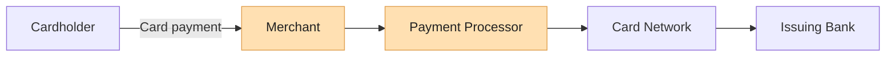
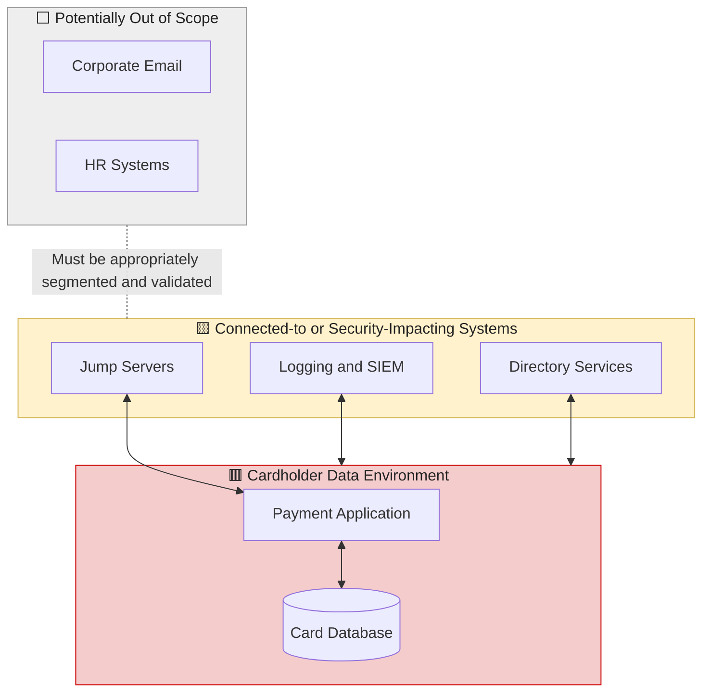
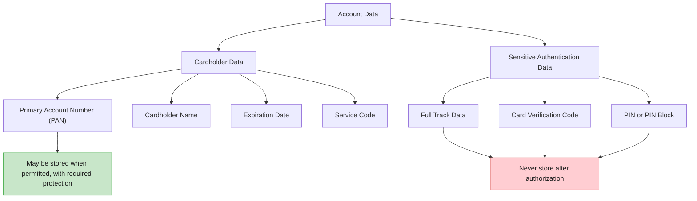
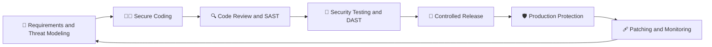
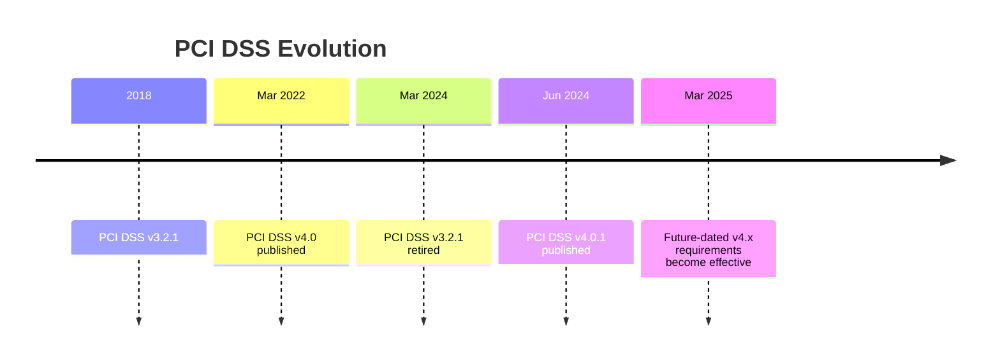

# PCI DSS v4.0.1: Learning Summary

My learning notes after completing the **PCI DSS v4.0.1 course on Codebashing**, focusing on how the standard protects payment card data and what it means for secure software development.


---

##  Contents

1. [What is PCI DSS?](#-what-is-pci-dss)
2. [The 6 Goals and 12 Requirements](#-the-6-goals-and-12-requirements)
3. [Scope: What Is In and What Is Out](#-scope-what-is-in-and-what-is-out)
4. [Cardholder Data: What You Can and Cannot Store](#-cardholder-data-what-you-can-and-cannot-store)
5. [Secure Software Under Requirement 6](#-secure-software-under-requirement-6)
6. [Key Changes in v4.x](#-key-changes-in-v4x)
7. [Key Takeaways](#-key-takeaways)
8. [References](#-references)

---

##  What Is PCI DSS?

The **Payment Card Industry Data Security Standard (PCI DSS)** is a set of security requirements designed to protect payment account data. It applies to organizations that store, process, or transmit payment account data, as well as systems that can affect the security of the cardholder data environment.

The standard is maintained by the **PCI Security Standards Council (PCI SSC)**. Version 4.0.1, published in June 2024, clarified and refined aspects of version 4.0 without introducing new requirements.

### How a card payment works



**Key lesson:** Organizations must understand how payment data flows through their systems and determine their PCI DSS responsibilities.

---

##  PCI DSS v4.0.1: Six Goals and 12 Principal Requirements

PCI DSS v4.0.1 is structured into **six high-level security goals and 12 principal requirements**. Each principal requirement contains more detailed, numbered requirements and associated testing procedures.

### Understanding the hierarchy

| Level | Meaning | Example |
|---|---|---|
| **Level 1 — Security goal** | One of the six broad goals of the standard. | Goal 3: Maintain a Vulnerability Management Program |
| **Level 2 — Principal requirement** | One of the 12 main requirement areas. | Requirement 6: Develop and Maintain Secure Systems and Software |
| **Level 3 — Sub-requirement** | A more specific, numbered security requirement. | Requirement 6.2.4 |
| **Level 4 — Testing procedures** | Procedures used to assess whether the applicable requirements are met. | Testing procedures associated with Requirement 6.2.4 |

*Note: The examples illustrate the numbering hierarchy. Consult the official PCI DSS v4.0.1 standard for the complete wording, applicability, and testing procedures.*

### Visual map: Six goals → 12 principal requirements

```mermaid
flowchart TB
    ROOT["PCI DSS v4.0.1"]

    ROOT --> G1["GOAL 1<br/>Build and Maintain a Secure Network and Systems"]
    ROOT --> G2["GOAL 2<br/>Protect Account Data"]
    ROOT --> G3["GOAL 3<br/>Maintain a Vulnerability Management Program"]
    ROOT --> G4["GOAL 4<br/>Implement Strong Access Control Measures"]
    ROOT --> G5["GOAL 5<br/>Regularly Monitor and Test Networks"]
    ROOT --> G6["GOAL 6<br/>Maintain an Information Security Policy"]

    G1 --> R1["REQ 1<br/>Network Security Controls"]
    G1 --> R2["REQ 2<br/>Secure Configurations"]

    G2 --> R3["REQ 3<br/>Protect Stored Account Data"]
    G2 --> R4["REQ 4<br/>Protect Cardholder Data in Transit"]

    G3 --> R5["REQ 5<br/>Protect Against Malicious Software"]
    G3 --> R6["REQ 6<br/>Secure Systems and Software"]

    G4 --> R7["REQ 7<br/>Restrict Access by Business Need to Know"]
    G4 --> R8["REQ 8<br/>Identify Users and Authenticate Access"]
    G4 --> R9["REQ 9<br/>Restrict Physical Access"]

    G5 --> R10["REQ 10<br/>Log and Monitor Access"]
    G5 --> R11["REQ 11<br/>Test Security Regularly"]

    G6 --> R12["REQ 12<br/>Maintain Information Security Policies and Programs"]

    style ROOT fill:#17365d,color:#ffffff,stroke:#17365d
    style G1 fill:#d9eaf7,color:#17365d,stroke:#5b9bd5
    style G2 fill:#d9eaf7,color:#17365d,stroke:#5b9bd5
    style G3 fill:#d9eaf7,color:#17365d,stroke:#5b9bd5
    style G4 fill:#d9eaf7,color:#17365d,stroke:#5b9bd5
    style G5 fill:#d9eaf7,color:#17365d,stroke:#5b9bd5
    style G6 fill:#d9eaf7,color:#17365d,stroke:#5b9bd5
```



### Goal 1 — Build and Maintain a Secure Network and Systems

| Principal requirement | Official requirement title |
|---|---|
| **Requirement 1** | Install and Maintain Network Security Controls |
| **Requirement 2** | Apply Secure Configurations to All System Components |

**Focus:** Network security controls, segmentation, secure configurations, and removal of insecure defaults.

### Goal 2 — Protect Account Data

| Principal requirement | Official requirement title |
|---|---|
| **Requirement 3** | Protect Stored Account Data |
| **Requirement 4** | Protect Cardholder Data with Strong Cryptography During Transmission Over Open, Public Networks |

**Focus:** Data minimization, storage protection, cryptographic controls, and secure transmission.

### Goal 3 — Maintain a Vulnerability Management Program

| Principal requirement | Official requirement title |
|---|---|
| **Requirement 5** | Protect All Systems and Networks from Malicious Software |
| **Requirement 6** | Develop and Maintain Secure Systems and Software |

**Focus:** Malware protection, vulnerability remediation, secure development, code review, and application security.

### Goal 4 — Implement Strong Access Control Measures

| Principal requirement | Official requirement title |
|---|---|
| **Requirement 7** | Restrict Access to System Components and Cardholder Data by Business Need to Know |
| **Requirement 8** | Identify Users and Authenticate Access to System Components |
| **Requirement 9** | Restrict Physical Access to Cardholder Data |

**Focus:** Least privilege, unique user identification, authentication, access reviews, and physical security.

### Goal 5 — Regularly Monitor and Test Networks

| Principal requirement | Official requirement title |
|---|---|
| **Requirement 10** | Log and Monitor All Access to System Components and Cardholder Data |
| **Requirement 11** | Test Security of Systems and Networks Regularly |

**Focus:** Logging, monitoring, vulnerability scanning, penetration testing, and detection of unauthorized changes.

### Goal 6 — Maintain an Information Security Policy

| Principal requirement | Official requirement title |
|---|---|
| **Requirement 12** | Support Information Security with Organizational Policies and Programs |

**Focus:** Security governance, risk assessments, awareness, incident response, and third-party service-provider management.

### Understanding PCI DSS requirement numbering

PCI DSS uses hierarchical identifiers to distinguish principal requirements from more detailed controls.

| Identifier | What it means |
|---|---|
| **6** | Principal Requirement 6 |
| **6.2** | A specific requirement area within Requirement 6 |
| **6.2.4** | A more detailed requirement within Requirement 6.2 |
| **11.6.1** | A detailed requirement under Requirement 11, concerning payment-page change and tamper detection |

The applicable testing procedures and any sub-requirement suffixes must be checked against the official PCI DSS v4.0.1 document.

### Key distinction

**Six goals organize the standard. Twelve principal requirements define its main security domains. Sub-requirements provide more specific requirements that can be assessed and tested.**

PCI DSS v4.0.1 was published in June 2024 as a limited revision of v4.0. It did not add or remove principal requirements.

**Official reference:** [PCI SSC Document Library — PCI DSS v4.0.1](https://www.pcisecuritystandards.org/document_library/)

##  Scope: What Is In and What Is Out?

The **Cardholder Data Environment (CDE)** consists of the people, processes, and technologies that store, process, or transmit cardholder data or sensitive authentication data.

Systems connected to the CDE, or that can affect its security, may also be in scope. Scope exclusions must be justified through appropriate controls and validation.



### How can organizations reduce scope?

- **Network segmentation:** Separate the CDE from other networks using properly implemented and validated controls.
- **Tokenization:** Replace PAN with a token to reduce the exposure of the original card number.
- **Payment outsourcing:** Use a qualified service provider where appropriate, while retaining responsibility for applicable merchant controls.
- **Scope validation:** Confirm the scope at least once every 12 months and after significant changes, as required.

 **Key lesson:** Reducing unnecessary exposure to cardholder data can reduce risk and compliance effort, but it does not automatically eliminate PCI DSS responsibilities.

---

##  Cardholder Data: What You Can and Cannot Store

Understanding the difference between cardholder data and sensitive authentication data is essential.



*Note: Cardholder name, expiration date, and service code are cardholder data when associated with a PAN. The PAN must be rendered unreadable wherever stored as required by PCI DSS. Sensitive authentication data must not be stored after authorization, even if encrypted.*

### Common data protection techniques

| Technique | What it does | Example |
|---|---|---|
| **Masking** | Conceals digits when displaying a PAN. | `4111 11•• •••• 1111` |
| **Truncation** | Permanently removes or omits portions of a PAN from stored or displayed data. | Retaining only permitted digits. |
| **Tokenization** | Replaces a PAN with a token that has no exploitable mathematical relationship to the original PAN. | `tok_8f3a...` |
| **Hashing** | Uses a cryptographic hash; PCI DSS specifies keyed cryptographic hashes for rendering PAN unreadable through hashing. | A suitable keyed hash. |
| **Encryption** | Transforms data into ciphertext using cryptographic keys. | Strong encryption with secure key management. |

 **Rule of thumb:** If you do not need the data, do not store it.

---

## Secure Software Under Requirement 6

Requirement 6 is especially relevant to secure software development, application security, and vulnerability management.



### Important secure development practices

| Area | What it means in practice |
|---|---|
| Secure development | Follow secure software development practices throughout the lifecycle. |
| Developer training | Train software personnel in security at least once every 12 months, as required. |
| Common attacks | Protect against injection, cross-site scripting, and broken access control. |
| Code review | Review custom code before release to production, using qualified personnel and the required independence. |
| Vulnerability management | Identify, risk-rank, and remediate vulnerabilities according to applicable requirements. |
| Software inventory | Maintain an inventory of bespoke and custom software and third-party components. |
| Public-facing web applications | Protect against attacks using an appropriate solution, such as a web application firewall, or other permitted methods. |
| Payment-page scripts | Authorize, assure the integrity of, and maintain an inventory of payment-page scripts; implement tamper detection as required. |

### Common attack patterns and defenses

| Attack | Risk | Defense |
|---|---|---|
| SQL injection | Unauthorized access to payment or customer data. | Parameterized queries and input validation. |
| Cross-site scripting (XSS) | Session theft or malicious page modification. | Context-aware output encoding and an appropriate Content Security Policy. |
| Broken access control | Users access data or functions they are not authorized to use. | Server-side authorization checks and least privilege. |
| Sensitive data in logs | PAN or other sensitive information is exposed. | Exclude sensitive data or apply required masking and protections. |
| Hardcoded secrets | Credentials and keys are exposed in source code. | Use a secrets manager and rotate exposed credentials. |
| Payment-page skimming | Malicious scripts steal payment data from the browser. | Script authorization, integrity checks, and tamper detection. |

### Example: SQL injection

** Vulnerable code**

```python
# User input is concatenated directly into the SQL query.
cursor.execute("SELECT * FROM cards WHERE user = '" + user + "'")
```

** Safer approach**

```python
# Use a parameterized query.
cursor.execute("SELECT * FROM cards WHERE user = %s", (user,))
```

Parameterized queries help prevent user input from being interpreted as SQL syntax. The exact parameter syntax depends on the database driver.

**Key lesson:** Security must be integrated into development, testing, deployment, and maintenance—not treated as a final check before release.

---

##  Key Changes in PCI DSS v4.x



Important themes in version 4.x include:

- 🔄 **Customized approach:** Allows eligible requirements to be met through alternative controls that achieve the stated security objectives, with appropriate validation and documentation.
- 🔑 **Stronger authentication:** Strengthens authentication expectations, including MFA requirements for applicable access.
- 📊 **Targeted risk analysis:** Requires documented risk analysis to determine certain control frequencies where permitted.
- 🌐 **Payment-page protection:** Strengthens protections against unauthorized script changes and e-skimming.
- 👥 **Defined responsibilities:** Requires clear assignment of responsibilities for applicable security controls.
- 🔁 **Continuous security:** Emphasizes ongoing control operation, monitoring, and improvement rather than compliance as a once-a-year activity.

**Important date:** Future-dated requirements in PCI DSS v4.0 became effective on 31 March 2025. Version 4.0.1 did not restart that timeline.

---

## Key Takeaways

1. **PCI DSS is a security baseline.** Compliance is important, but organizations must also manage threats beyond the standard's minimum requirements.
2. **Scope matters.** Understand where payment data flows, which systems can affect its security, and how exposure can be reduced.
3. **Protect sensitive authentication data.** Never store it after authorization.
4. **Secure software throughout its lifecycle.** Apply secure coding, code review, testing, patching, and monitoring.
5. **Access control is fundamental.** Least privilege, appropriate authentication, and regular access reviews help prevent unauthorized access.
6. **Evidence matters.** Documented controls, assigned responsibilities, monitoring, and remediation support effective security governance.
7. **Compliance is continuous.** Controls must remain effective as applications, infrastructure, threats, and business processes change.

### My learning reflection

Completing the PCI DSS v4.0.1 course helped me connect payment card security requirements with practical cybersecurity concepts, including access governance, vulnerability management, secure software development, and audit readiness.

This is knowledge I can continue building on as I grow in information security and cybersecurity governance.

---

##  References

- [PCI Security Standards Council — Document Library](https://www.pcisecuritystandards.org/document_library/)
- [PCI Security Standards Council — Official Website](https://www.pcisecuritystandards.org/)
- Codebashing — PCI DSS v4.0.1 course.

> **Disclaimer:** These are personal learning notes written in my own words following course completion. They are intended for educational purposes and do not replace the official PCI DSS standard, professional assessment, or formal certification.

---

**Course completed:** 29 October 2026  
**Learning platform:** Codebashing  
**Topic:** Payment Card Security and Secure Software Development
